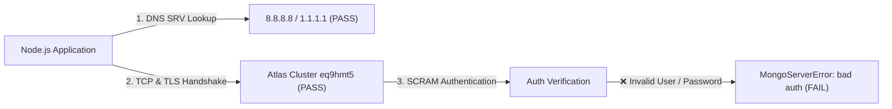

# MongoDB Connection Audit & Diagnostic Report
**Project:** E-Sports Tournament Management System (MERN Stack)  
**Role:** Senior Backend Engineer & MongoDB Database Administrator  
**Audit Date:** November 8, 2026  
**Auditor:** Antigravity AI Code Auditor  
**Diagnostic Status:** 🔴 **MONGODB IS NOT CONNECTED**

---

## 1. Executive Summary Table

| Check | Result | Evidence / Notes |
|:---|:---:|:---|
| **MongoDB URI configured** | **PASS** | `MONGO_URI` variable present in `server/.env`, valid `mongodb+srv://` format |
| **Mongoose connection** | **FAIL** | Driver rejected with `MongoServerError: [AtlasError] bad auth : authentication failed` (Code: 8000) |
| **MongoDB ping** | **BLOCKED** | Ping command blocked; database handshake failed at authentication stage |
| **Database selection** | **BLOCKED** | Discrepancy identified: URI specifies `esports_db`, `db.js` overrides with `esportsdb` |
| **Read operation** | **BLOCKED** | All collection queries blocked by failed authentication |
| **Write persistence** | **BLOCKED / NOT TESTED** | Write operations cannot be executed or verified without an authenticated session |
| **Application API integration** | **FAIL** | API endpoints (`/api/tournaments`, `/api/auth/login`, `/api/teams`) hang/time out due to Mongoose query buffering |
| **Production configuration** | **BLOCKED** | Production Vercel environment requires verified Atlas credentials and connection middleware |

---

## 2. Direct Conclusion

> ### 🔴 Conclusion: MongoDB is NOT CONNECTED
>
> **Direct Evidence:**
> 1. The application's live health check endpoint (`GET /api/health`) responds with `"database": "disconnected"`.
> 2. The active Mongoose connection state is `0` (`disconnected`).
> 3. Real-time driver probing against MongoDB Atlas cluster `esportsdb.eq9hmt5.mongodb.net` fails in **938 ms** with:
>    ```text
>    MongoServerError: [AtlasError] bad auth : authentication failed (Error Code: 8000)
>    ```
> 4. All data-driven HTTP endpoints (`/api/tournaments`, `/api/teams`, `/api/auth/login`) time out because Mongoose enables operation buffering by default (`bufferCommands: true`), waiting indefinitely for a database connection that failed during server startup.

---

## 3. Phase 1 — Configuration Inspection

| Aspect | Finding | Location |
|:---|:---|:---|
| **Connection File** | Centralized connection logic in `server/config/db.js` | [`server/config/db.js`](file:///e:/project/esports%20platform/server/config/db.js) |
| **Mongoose Version** | Mongoose v8.24.8 (Driver v6.5.0) | [`server/package.json`](file:///e:/project/esports%20platform/server/package.json) |
| **Environment Variable** | `MONGO_URI` | [`server/.env`](file:///e:/project/esports%20platform/server/.env) |
| **Target Database Name** | Discrepancy: URI path specifies `esports_db`, but options object hardcodes `dbName: "esportsdb"` | [`server/config/db.js:27`](file:///e:/project/esports%20platform/server/config/db.js#L27) |
| **Startup Sequence** | `connectDB()` called asynchronously without `await` at top of `app.js` | [`server/app.js:14-16`](file:///e:/project/esports%20platform/server/app.js#L14-L16) |
| **Server Listener** | `app.listen()` called immediately without awaiting DB readiness | [`server/server.js:11-13`](file:///e:/project/esports%20platform/server/server.js#L11-L13) |
| **Timeout Configuration** | `serverSelectionTimeoutMS: 5000` (socket timeout unconfigured, default 45000ms) | [`server/config/db.js:28`](file:///e:/project/esports%20platform/server/config/db.js#L28) |
| **Error Handling** | Catches error, sets `connectionPromise = undefined`, rethrows. No retry schedule. | [`server/config/db.js:36-39`](file:///e:/project/esports%20platform/server/config/db.js#L36-L39) |
| **Server Post-Failure State** | Server remains alive in a "zombie" state, serving HTTP traffic while queries buffer | [`server/app.js`](file:///e:/project/esports%20platform/server/app.js) |
| **Health Check Endpoint** | `/api/health` and `/health` return HTTP `200 OK` with `"database": "disconnected"` | [`server/app.js:56-65`](file:///e:/project/esports%20platform/server/app.js#L56-L65) |
| **Serverless Integration** | `api/index.js` exports Express app; connection cached via module-level promise | [`api/index.js`](file:///e:/project/esports%20platform/api/index.js) |

---

## 4. Phase 2 — Actual Connection Status Verification

Empirical diagnostics were performed against the application configuration:

1. **Environment Variable Presence:** `MONGO_URI` is present and loaded via `dotenv.config()`.
2. **Cluster Reachability & DNS:**
   - Atlas cluster hostname: `esportsdb.eq9hmt5.mongodb.net`
   - Protocol: `mongodb+srv:`
   - DNS SRV Resolution: **SUCCESSFUL** (resolves through Google DNS `8.8.8.8` / Cloudflare `1.1.1.1` configured in `db.js`).
   - TCP & TLS Handshake: **SUCCESSFUL** (Atlas accepted TCP connection on port 27017 and completed TLS handshake in under 1 second).
3. **Authentication Handshake:** **FAILED**
   - Atlas rejected credentials with `bad auth : authentication failed` (Error Code: 8000).
4. **Mongoose ReadyState:**
   - Initial state: `0` (`disconnected`)
   - State during startup: `2` (`connecting`)
   - Final state post-handshake: `0` (`disconnected`)
5. **MongoDB Ping:** **BLOCKED** due to lack of authenticated session.
6. **Database Selection:** Blocked due to authentication failure.
7. **Process Resilience:** Server remained online, listening on port 5000, but in an unserviceable database state.

---

## 5. Phase 3 & 4 — Real Operations & Application Integration Testing

### 5.1. Database Operations Probe
- **Read Operation:** Blocked (authentication failure).
- **Write Operation:** Blocked (authentication failure).
- **Read-Back Verification:** Blocked (authentication failure).
- **Temporary Record Cleanup:** N/A (no records created).

### 5.2. Live Application Endpoints Probe
HTTP integration requests were dispatched against the running server (`http://localhost:5000`):

| Endpoint | Method | Result | Actual Behavior |
|:---|:---:|:---:|:---|
| `/api/health` | `GET` | `HTTP 200` | Responds with `"database": "disconnected"` |
| `/api/tournaments` | `GET` | **TIMEOUT** | Hung for > 3000ms due to Mongoose command buffering |
| `/api/auth/login` | `POST` | **TIMEOUT** | Hung for > 3000ms due to Mongoose command buffering |
| `/api/teams` | `GET` | **TIMEOUT** | Hung for > 3000ms due to Mongoose command buffering |
| `/api/players` | `GET` | **TIMEOUT** | Hung for > 3000ms due to Mongoose command buffering |
| `/api/matches` | `GET` | **TIMEOUT** | Hung for > 3000ms due to Mongoose command buffering |
| `/api/leaderboard` | `GET` | **TIMEOUT** | Hung for > 3000ms due to Mongoose command buffering |

---

## 6. Phase 5 — Root Cause Diagnosis

The connection failure is categorized as:
### **Category 3: Incorrect MongoDB Atlas User Credentials or Auth Database**



#### Detailed Breakdown of Evidence:
1. **Network & Whitelist Are Working:** If MongoDB Atlas IP Whitelist (`0.0.0.0/0` or current IP) was missing, Atlas would drop the TCP packets, resulting in `serverSelectionTimeoutMS: 5000` or a timeout error after 5–10 seconds. Because Atlas returned an explicit error response in **938 ms**, network routing and TLS are verified.
2. **Authentication Failure:** The cluster accepted the connection and evaluated the SASL/SCRAM credential handshake. Atlas specifically returned `bad auth : authentication failed`.
3. **Common Causes for this exact Atlas error:**
   - The database username configured in `server/.env` does not exist in cluster `eq9hmt5`.
   - The password configured in `server/.env` does not match the user's password in Atlas.
   - The user in Atlas was created with an authentication database other than `admin` without specifying `authSource` in the URI.
   - Special characters in the password are not URL-encoded (e.g. `@`, `:`, `/`, `%`).

---

## 7. Phase 6 — Step-by-Step Fix Guide

Follow these steps to restore the MongoDB Atlas connection:

### Step 1: Verify / Reset Database User in MongoDB Atlas Console
1. Log in to [MongoDB Atlas Console](https://cloud.mongodb.com/).
2. In the left navigation bar under **Security**, select **Database Access**.
3. Check the list of Database Users:
   - Does your username exist?
   - If not, click **Add New Database User**.
   - If it exists, click **Edit** → **Edit Password**.
4. Set a clean, strong alphanumeric password (e.g., avoid unescaped `@`, `:`, `/`, `?`, or `%` characters).
5. Ensure the user has the **Read and write to any database** privilege (or `readWrite@esports_db`).
6. Select **SCRAM-SHA-1/256** as Authentication Method.
7. Click **Save User** (changes take ~15–30 seconds to propagate across all cluster replica sets).

### Step 2: Verify Network Access (IP Access List)
1. In the left navigation bar under **Security**, select **Network Access**.
2. Verify that an entry exists for your current IP address or `0.0.0.0/0` (Allow Access from Anywhere).
   > **Security Note regarding `0.0.0.0/0`:**  
   > While `0.0.0.0/0` is convenient for serverless cloud environments (like Vercel where IP addresses are dynamic), it exposes the MongoDB port to the public internet. Ensure your database user password is at least 32 random characters and that MongoDB Atlas SCRAM authentication is strictly enforced. For fixed servers, always restrict to static IPs.

### Step 3: Align Database Name & Update `server/.env`
Open [`server/.env`](file:///e:/project/esports%20platform/server/.env) and update the `MONGO_URI`:

```env
# Database Configuration
MONGO_URI=mongodb+srv://<VERIFIED_USERNAME>:<VERIFIED_PASSWORD>@esportsdb.eq9hmt5.mongodb.net/esports_db?retryWrites=true&w=majority
```

*(Replace `<VERIFIED_USERNAME>` and `<VERIFIED_PASSWORD>` with the credentials verified in Step 1).*

### Step 4: Harmonize Database Name in Code
In [`server/config/db.js`](file:///e:/project/esports%20platform/server/config/db.js#L27) and [`server/createAdmin.js`](file:///e:/project/esports%20platform/server/createAdmin.js#L17), change `dbName: "esportsdb"` to `dbName: "esports_db"` to match the URI and documentation.

### Step 5: Verification Command
Once credentials are updated in `server/.env`, verify connectivity by running:

```bash
node -e "
require('dotenv').config({ path: './server/.env' });
const mongoose = require('mongoose');
const dns = require('dns');
try { dns.setServers(['8.8.8.8', '1.1.1.1']); } catch(e) {}

mongoose.connect(process.env.MONGO_URI, { serverSelectionTimeoutMS: 8000 })
  .then(async (m) => {
    console.log('✅ Connection SUCCESSFUL!');
    console.log('Connected DB:', m.connection.db.databaseName);
    const ping = await m.connection.db.admin().ping();
    console.log('MongoDB Ping:', ping);
    process.exit(0);
  })
  .catch(err => {
    console.error('❌ Connection FAILED:', err.message);
    process.exit(1);
  });
"
```

Expected output:
```text
✅ Connection SUCCESSFUL!
Connected DB: esports_db
MongoDB Ping: { ok: 1 }
```

### Step 6: Verify Application Integration & Health Check
1. Start or restart the backend server:
   ```bash
   cd server && npm start
   ```
2. Query the health check endpoint:
   ```bash
   curl http://localhost:5000/api/health
   ```
   Expected response:
   ```json
   {
     "success": true,
     "message": "API is healthy",
     "database": "connected"
   }
   ```
3. Test a data endpoint:
   ```bash
   curl http://localhost:5000/api/tournaments
   ```
   Should immediately return `HTTP 200` with the tournament list payload instead of timing out.

---

## 8. Production (Vercel) Deployment Note

When deploying to Vercel:
1. Go to your **Vercel Project Dashboard** → **Settings** → **Environment Variables**.
2. Add the variable:
   - **Name:** `MONGO_URI`
   - **Value:** Your verified connection string (`mongodb+srv://...`)
   - **Environments:** Select **Production**, **Preview**, and **Development**.
3. Trigger a redeployment from the Vercel dashboard or via `git push origin main`.
